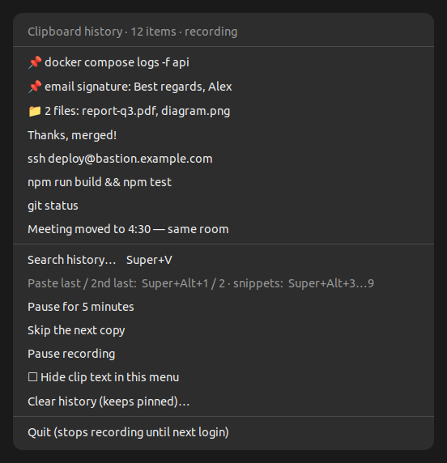
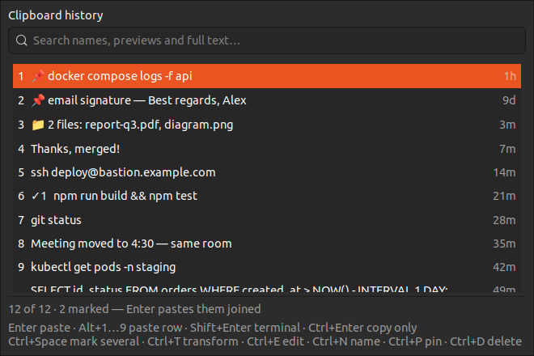

# Clip Keeper

A private clipboard history in the GNOME top bar, for text **and screenshots**.

- **Super+V** drops the history down from the top bar. Search it and press
  **Enter**: the clip is pasted straight into the box you were typing in.
- **Super+Alt+1** / **Super+Alt+2** paste your last and second-last copied
  items, without opening anything. **Super+Alt+3…9** paste your snippets.
- Search the **full text** of every clip, paste **several clips at once**,
  paste **transformed** (JSON, Base64, URL, case…) or **edit before pasting**.
- Optional **encryption at rest**, with the key in GNOME Keyring.

Built for Ubuntu with GNOME on **Wayland**, and built so it **doesn't break when
GNOME or Ubuntu is upgraded**: there's no GNOME Shell extension and no private
GNOME internals involved.





## What it does

- **Records your copies** while it runs in the top bar:
  - text, keeping its **formatting** (HTML) too, so a pasted clip stays bold
    or linked where the target app supports it
  - images (screenshots, copied pictures)
  - **files copied in Files (Nautilus)**: paste them again in Files, or as
    paths into a text box
  - Copying the same thing again moves it back to the top instead of adding a
    duplicate.
  - The newest **500** unpinned clips are kept, of which at most **50** are
    images, so screenshots can't fill your disk. Unpinned clips older than
    **7 days** are deleted (`clip-keeper expire DAYS`, `0` = never).
    **Pinned** clips are kept forever and don't count towards any limit.
- **Top-bar menu:**
  - your latest clips; click one to copy it again
  - **Search history…**
  - **Pause for 5 minutes**, **Skip the next copy**, **Pause recording**
  - **Hide clip text in this menu** (shows "Clip 1, Clip 2…" for screen
    sharing)
  - **Clear history** (keeps pinned clips)
- **Super+V dropdown.** It opens under the top bar at the top-right, like the
  tray menu, and closes when you click elsewhere. GNOME doesn't let apps open a
  tray icon's own menu from a shortcut without a Shell extension, so this is
  the upgrade-safe equivalent.
  - search box at the top. Matching is fuzzy on names and previews, so `gsp`
    finds `git stash pop`, and it also searches the **full text** of long
    clips beyond the preview.
  - the first nine rows are numbered; images show as thumbnails
  - `↑`/`↓` to move, `Esc` to close
  - `Enter` pastes into the window you came from
  - `Alt+1…9` pastes that row directly
  - `Shift+Enter` pastes into a terminal (with Ctrl+Shift+V)
  - `Ctrl+Enter` only copies
  - `Ctrl+Space` marks several clips; `Enter` then pastes them **joined by
    newlines**, in the order you marked them
  - `Ctrl+T` **paste transformed**:
    - plain text, without formatting
    - trim whitespace, or join into one line
    - JSON pretty / compact
    - URL encode / decode, Base64 encode / decode
    - UPPER / lower / Title case
  - `Ctrl+E` **edit before pasting** (the edited text isn't saved)
  - `Ctrl+N` **names** a clip, which makes it a pinned snippet
  - `Ctrl+P` to pin, `Ctrl+D` to delete, `Ctrl+Shift+Delete` to clear
- **Quick paste.** `Super+Alt+1` pastes the last thing you copied and
  `Super+Alt+2` the one before. "Last" means copy time, so pinned clips don't
  jump the queue. Tap the shortcut: the paste happens just after you let go of
  the keys.
- **Snippets.** Pinned clips are your snippets: named ones first, by name,
  then the other pinned clips. `Super+Alt+3` pastes snippet 1, up to
  `Super+Alt+9` for snippet 7. `clip-keeper snippets` lists which key pastes
  what.
- Text that Clip Keeper puts on the clipboard itself (transformed, edited or
  joined clips) isn't recorded as a new copy.
- **Private by default:**
  - It never stores anything a password manager marks as secret: KeePassXC,
    1Password and others set the `x-kde-passwordManagerHint` flag.
  - It never stores text that looks like a credential:
    - private keys
    - GitHub, GitLab, Slack, OpenAI, Stripe, AWS, Google, npm, PyPI and
      SendGrid tokens
    - JWTs, and `Bearer` or `Basic` auth headers
    - connection strings or `curl -u` with a password
    - `PASSWORD=…` / `api_key: …` style pairs

    Turn this off with `clip-keeper secret-filter off`.
  - The history is only readable by you (folder 0700, files 0600). Sorting
    happens in memory, so clip text never goes to temporary files.
  - Deleting or clearing clips overwrites them in the database, and SQLite's
    write-ahead log is emptied straight away. This is best effort: SSDs,
    filesystem journals and your own backups can still hold old copies.
  - Use **Skip the next copy** or **Pause for 5 minutes** before copying
    something sensitive that a password manager doesn't flag. Not every
    password manager or browser marks its copies as secret.
  - **Encryption at rest** (opt-in, `clip-keeper encrypt on`):
    - Clip text, previews, names, formatting, file lists and images are
      encrypted with AES-256-GCM.
    - Duplicate detection uses a keyed hash, so even fingerprints reveal
      nothing.
    - The random key lives in **GNOME Keyring**, which unlocks with your
      login, so a copy of your home folder alone is unreadable.
    - Trade-offs: copycat can't read an encrypted history, and search scans
      the decrypted clips in memory instead of the full-text index (the index
      would hold plain text, so it's removed).
    - `clip-keeper encrypt off` decrypts everything again and deletes the key.
    - What it doesn't hide: each clip's kind (text, image, files), when it was
      copied, whether it's pinned, and its rough size.
    - It protects the history at rest, for example in a backup or on a
      stolen disk. It doesn't protect against other programs running as you,
      which can ask GNOME Keyring for the key, just as they could read your
      screen or clipboard.

**How auto-paste works on Wayland.** Wayland doesn't let one app type into
another. So clip-keeper creates a tiny **virtual keyboard** through the Linux
kernel's `uinput` device, and that keyboard presses Ctrl+V after the popup
closes:

- It works in every app.
- It relies only on a kernel interface that's been stable since Linux 4.5, so
  GNOME upgrades don't affect it.
- The package adds a standard udev rule (`uaccess`) that grants that device to
  the logged-in desktop user only. Members of the `input` group already have
  access.
- Turn it off with `clip-keeper auto-paste off`; Super+V then only copies.
- Key positions follow a US layout.

## Why it doesn't break on upgrades

| Piece | What it relies on |
|---|---|
| Recording | GNOME's built-in Wayland ↔ X11 clipboard relay (XWayland). This is core GNOME behaviour, the same mechanism that lets older X11 apps paste. |
| Top-bar icon | The AppIndicator protocol. Ubuntu ships support for it by default. |
| Super+V, Super+Alt+1…9 | GNOME's documented custom-shortcut settings (`gsettings`). |
| Starting and restarting | A systemd user service tied to the desktop session (`Restart=on-failure`). |
| Encryption key | The Secret Service API (GNOME Keyring), stable for over a decade. |
| Windows | GTK 3, which is stable and present on every GNOME desktop. |
| Auto-paste | The kernel's `uinput` virtual-keyboard API (stable since Linux 4.5). |

Clipboard managers built as GNOME Shell extensions can see the clipboard
directly, but they have to be updated for each GNOME release. Clip Keeper only
uses the pieces above.

## Compatible with copycat

The history lives at `~/.local/share/copycat/history.db`, in exactly the format
of [copycat](https://github.com/thedeceptio/copycat), a Rust clipboard manager.
That covers the same table, the same content fingerprints, previews, duplicate
collapsing and history limit. You can move between the two tools and keep your
whole history. Clip Keeper's extras (snippet names, formatting and the
full-text index) live in tables of their own, which copycat ignores. An
encrypted history is the one exception: copycat can't read it.

## Install (Ubuntu 22.04+ / GNOME)

Download `clip-keeper_<version>_all.deb` from the [Releases](../../releases)
page, or build it yourself (see *Build and develop* below). Then:

```bash
sudo apt install ./clip-keeper_*_all.deb
systemctl --user daemon-reload && systemctl --user start clip-keeper   # start recording now
clip-keeper bind-shortcut     # Super+V, Super+Alt+1…9 (GNOME's message tray stays on Super+M)
```

It then starts with every login as a systemd user service, and restarts by
itself if it ever crashes. **Quit** in its menu stops it until the next login.

**Uninstall:** run `sudo apt remove clip-keeper`. Super+V goes back to GNOME's
default, and your history file is left in place. Delete
`~/.local/share/copycat/` to remove the history.

## From a terminal

```bash
clip-keeper status              # recording or paused, how many clips, what was skipped and why
clip-keeper list [query] [-n N] # recent clips, optionally fuzzy-filtered
clip-keeper paste N [--terminal] # paste the N-th most recently copied clip (what Super+Alt+1/2 run)
clip-keeper snippets            # pinned clips and their Super+Alt+3…9 keys
clip-keeper name ID NAME…       # name a clip (pins it); without NAME removes the name
clip-keeper paste-snippet N     # paste snippet N (what Super+Alt+3…9 run)
clip-keeper pause [--minutes M] | resume
clip-keeper skip-next           # don't record the next copy
clip-keeper expire DAYS         # unpinned clips older than DAYS are deleted (default 7, 0 = never)
clip-keeper clear               # delete every unpinned clip
clip-keeper encrypt on|off      # encryption at rest, key in GNOME Keyring
clip-keeper secret-filter on|off
clip-keeper auto-paste on|off   # Super+V pastes, or only copies
clip-keeper images | files | rich-text on|off
clip-keeper private-menu on|off # "Clip 1, 2…" instead of clip text in the top-bar menu
clip-keeper bind-shortcut | unbind-shortcut
```

## Build and develop

```bash
packaging/build-deb.sh                        # → dist/clip-keeper_<version>_all.deb
python3 -m venv --system-site-packages .venv && .venv/bin/pip install pytest pytest-cov
.venv/bin/python -m pytest --cov
python3 docs/screenshots/generate.py          # regenerate the screenshots (demo data)
```

## License

[MIT](LICENSE)
